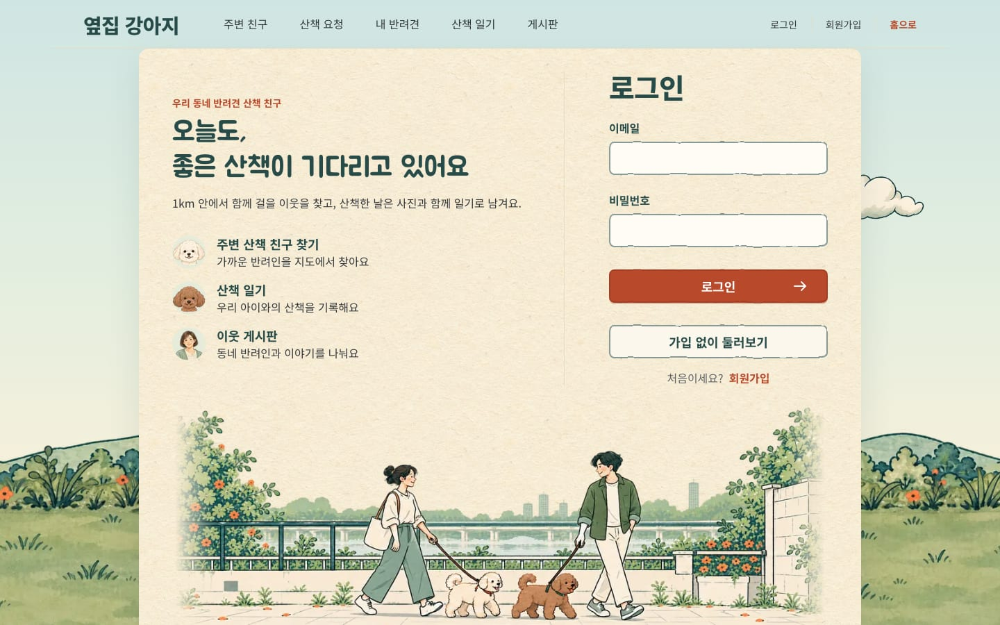
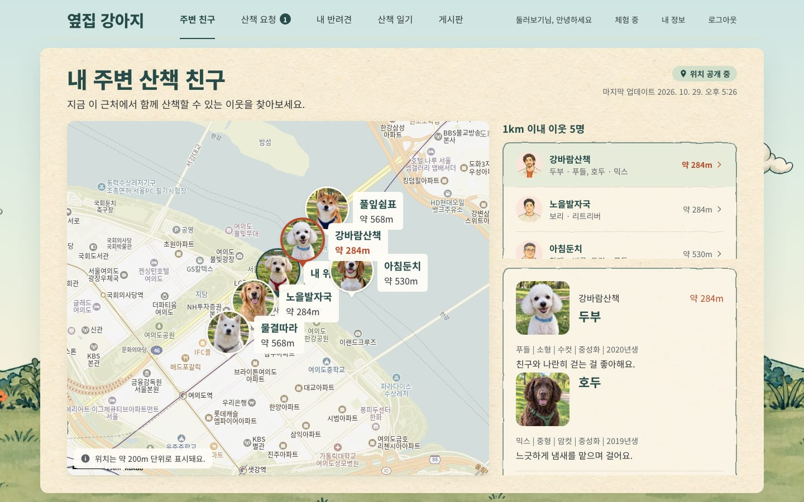
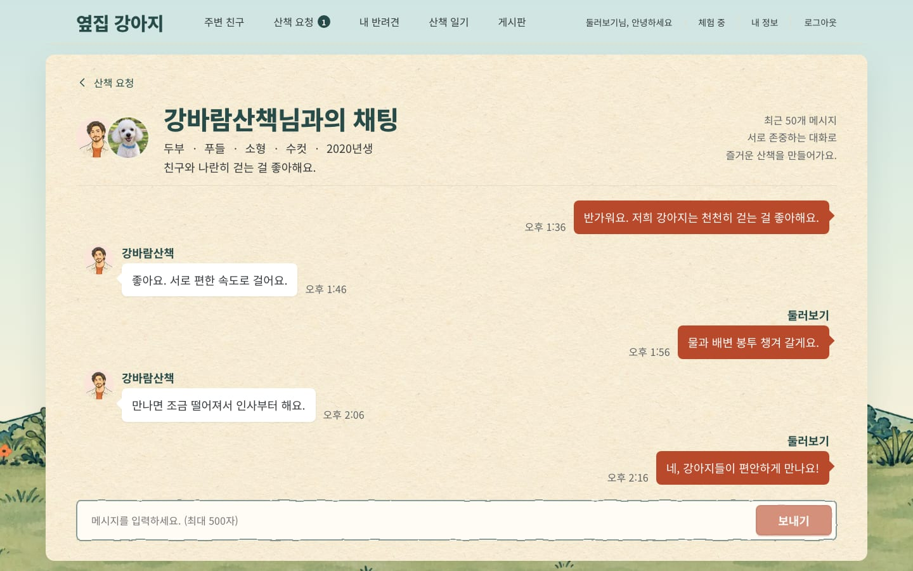
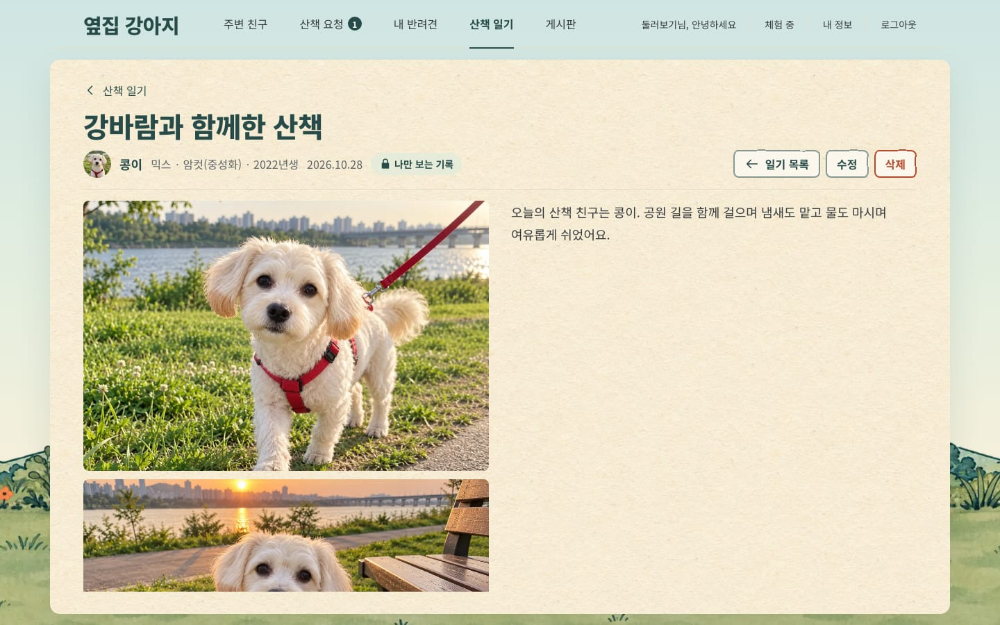
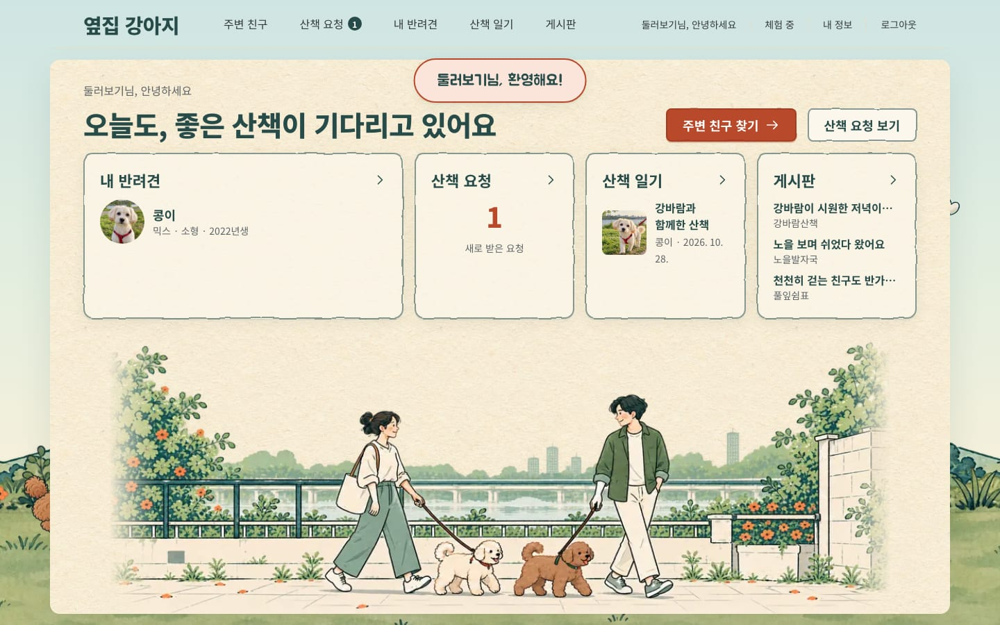
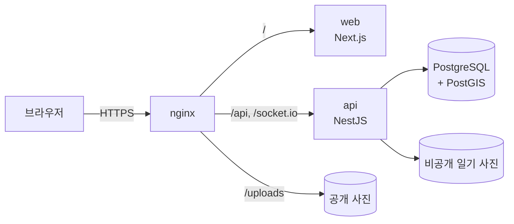

# 옆집 강아지

**동네 반려인과 산책 친구를 이어 주는 서비스.**
지도에서 1km 안의 이웃을 찾아 산책을 요청하고, 수락되면 실시간으로 대화합니다. 산책한 날은 사진과 함께 일기로 남기고, 게시판에서 이웃과 이야기를 나눕니다.

기획부터 디자인, 프론트엔드·백엔드 개발, 테스트, **집 데스크톱을 서버로 쓰는 온프레미스 배포와 운영**까지 혼자 진행한 개인 프로젝트입니다.

> **바로 써 보기: [dogwalk.changhyon.dev](https://dogwalk.changhyon.dev)**
>
> 로그인 화면의 **가입 없이 둘러보기** 버튼으로 미리 채워진 데모 계정에 바로 들어가 볼 수 있습니다.

## 화면

| 주변 산책 친구 | 실시간 채팅 |
|---|---|
|  |  |
| **산책 일기** | **홈** |
|  |  |

## 해결한 문제

### 같은 이웃에게 산책 요청을 동시에 보내면 요청이 두 개 생긴다

같은 두 사람 사이의 대기 중인 요청은 DB의 부분 유니크 인덱스로 하나만 허용합니다. 코드 분기가 아니라 DB 제약이 막으므로, 요청이 동시에 와도 하나만 남습니다.

### 반려견 삭제나 사진 교체가 동시에 실행되면 규칙이 깨진다

행 잠금(`SELECT ... FOR UPDATE`)으로 순서를 정해, "반려견은 최소 한 마리" 규칙이 지켜지고 교체된 사진이 주인 없이 남지 않게 했습니다. 디스크 오류로 파일 삭제가 실패하면 요청은 성공으로 끝내고 파일 이름을 로그에 남겨 직접 정리합니다.

### 로그인 요청을 한꺼번에 보내면 시도 제한을 넘을 수 있다

같은 IP에서 최근 15분 안에 실패가 5번 쌓이면 15분 동안 막습니다. 비밀번호 확인 **전에** 진행 중인 시도까지 함께 세어, 동시에 보낸 여러 요청도 제한을 넘지 못합니다.

### 위치와 사진으로 사는 곳이 드러날 수 있다

위치는 약 200m 단위로 흐려서 저장하고, 화면에도 그 단위로만 보여 줍니다. 올린 사진은 회전을 바로잡고 크기를 줄여 webp로 다시 저장하면서 촬영 위치 같은 메타데이터를 지웁니다. 일기 사진은 공개 폴더가 아닌 곳에 두고, 작성자 인증을 거친 API로만 내려줍니다.

### 로그인 토큰이 새어 나가면 계정을 계속 쓸 수 있다

접속 토큰은 브라우저 메모리에만 두고, 리프레시 토큰은 `HttpOnly`·`SameSite=Strict` 쿠키에 담아 인증 경로로만 보냅니다. 일반 계정은 리프레시 토큰의 해시만 DB에 저장하고, 로그인과 비밀번호 변경 때 새로 발급해 이전 리프레시 토큰을 무효로 만듭니다. 이미 발급된 접속 토큰은 발급 후 최대 30분까지만 유효합니다. 데모 계정은 방문자마다 DB에 저장하지 않는 별도 토큰을 씁니다. 현재 비밀번호 확인에도 계정별 시도 제한을 둡니다.

이 규칙들은 그 조건을 지우면 바로 실패하는 테스트로 지킵니다. API 단위·e2e(실제 DB), 웹 단위, Playwright 브라우저 테스트를 합쳐 약 940개이고, 배포 스크립트도 docker·curl 같은 명령을 가짜로 바꿔 실패 경로까지 테스트합니다.

## 주요 기능

- **주변 산책 친구**: 위치 공개에 동의한 이웃 중 1km 안에 있고 최근 5분 안에 위치를 보낸 사람을 지도와 목록으로 보여 줍니다(데모 지도는 미리 저장한 위치를 써서 5분 제한이 없습니다).
- **산책 요청**: 이웃과 반려견 정보를 보고 산책을 요청하면, 받은 사람은 실시간 알림을 받아 수락하거나 거절합니다.
- **채팅**: 수락된 요청의 두 사람만 Socket.IO로 대화합니다. 연결이 끊겼다 이어지면 최근 50개 메시지를 다시 불러옵니다.
- **산책 일기**: 반려견별로 사진(최대 5장)과 글을 남기는 나만 보는 기록입니다.
- **게시판**: 이웃과 글과 댓글을 나눕니다.
- **둘러보기(데모 계정)**: 가입 없이 데모 계정으로 주요 기능을 써 볼 수 있습니다. 닉네임·비밀번호·위치 변경과 사진 업로드는 막혀 있습니다. 방문자 모두가 같은 데모 계정을 함께 쓰므로 데모 일기도 공유되고, 데모 사용자와 실제 사용자는 서로 지도에 보이지 않습니다. 운영 서버에서는 데모 데이터가 서버가 켜질 때마다 처음 상태로 돌아가며, 이때 데모 글에 달린 댓글도 함께 지워집니다.
- **화면**: 손그림풍 일러스트와 종이 질감의 디자인 시스템을 직접 정리해 모든 화면에 적용했습니다. 일기·게시글 상세는 저장 직후 다시 요청하지 않고 저장 응답으로 바로 보여 주고, 새 작성 화면은 저장 뒤 깨끗하게 비웁니다.

## 기술 스택

| 영역 | 사용 기술 |
|---|---|
| 프론트엔드 | Next.js 16 (App Router), React 19, TanStack Query, Zustand, CSS Modules, Kakao 지도 |
| 백엔드 | NestJS 12, Prisma 7, Socket.IO, Passport JWT, sharp |
| 데이터베이스 | PostgreSQL 17 + PostGIS (위치 검색) |
| 인프라 | Docker Compose, nginx, Let's Encrypt, Ubuntu Server (집 데스크톱) |
| 테스트 | Vitest, Supertest, Playwright |

## 구조

앱의 요청은 nginx 한 곳으로만 갑니다(지도는 카카오에서 직접 받습니다). 화면과 API가 같은 출처라서 CORS 설정이 없고, DB와 앱 컨테이너는 바깥에 포트를 열지 않습니다.

## 온프레미스 홈 서버 배포

클라우드 대신 **집 데스크톱 한 대에 Ubuntu Server를 설치해 직접 배포하고 운영**합니다.

- Docker Compose로 nginx, web, api, db 네 컨테이너를 띄우고, 재부팅이나 정전 뒤에도 스스로 다시 켜지게 했습니다.
- DuckDNS와 공유기 포트포워딩으로 도메인을 연결하고, Let's Encrypt 인증서로 HTTPS를 적용했습니다.
- 서버가 켜질 때마다 DB와 사진을 USB로 백업하고, 업데이트는 스크립트 하나로 빌드부터 응답 확인까지 합니다.

자세히 보기

- **컨테이너 구성**: 재부팅이나 정전 뒤에도 스스로 다시 켜지도록 BIOS 전원 복구와 `restart: unless-stopped`를 함께 씁니다(백업하느라 멈춰 둔 api는 예외라 직접 켭니다).
- **HTTPS**: certbot(webroot 방식)으로 인증서를 받고, 인증서가 갱신되면 nginx를 자동으로 다시 읽힙니다. HTTP 요청은 HTTPS로 넘기고, 리프레시 쿠키는 HTTPS 전용으로 바뀝니다.
- **백업과 복원**: 서버 부팅 때 실행되도록 등록한 `deploy/on-boot.sh`가 앱 준비를 기다린 뒤 DB 덤프와 사진을 USB로 백업하고(14일이 지난 백업은 삭제), 이어서 데모 데이터를 초기화합니다. 백업에 실패해도 초기화는 계속합니다. DB와 사진이 같은 시점이 되도록 백업하는 동안 api를 잠깐 멈춥니다. 복원 스크립트는 백업이 온전한지 먼저 확인하고, 복원 뒤 로그인 서명 키를 바꿔 이전 세션을 끊습니다.
- **업데이트 스크립트**: `deploy/update.sh` 하나로 코드를 받아 다시 빌드하고 nginx를 새로 띄운 뒤, API와 화면이 모두 응답하는지 확인합니다. 백업·복원과 같은 잠금 파일을 써서 서로 겹치지 않고, 복원에 실패해 일부러 꺼 둔 앱은 다시 켜지 않습니다.
- **운영 안정성**: api가 종료 신호를 바로 받아 정상 종료되게 하고, 컨테이너 로그 크기를 제한했습니다. SSH는 집 안에서만 접속할 수 있게 막고, DB 포트는 서버 안(`127.0.0.1`)에만 엽니다.

